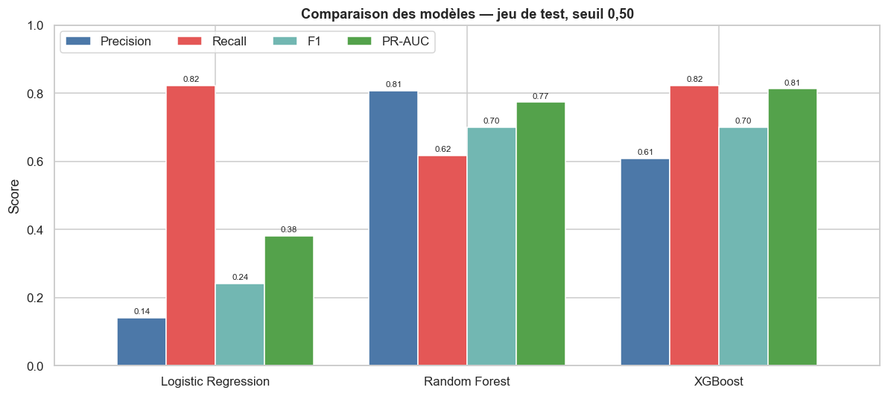
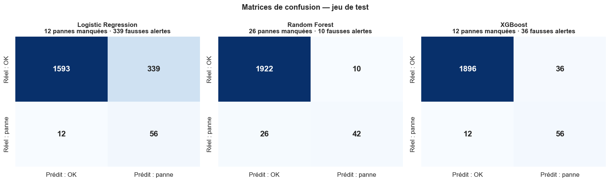
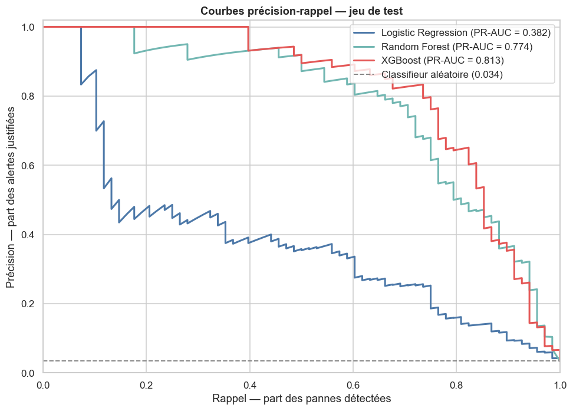
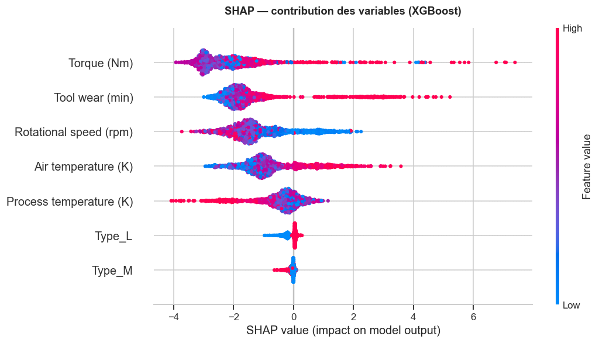
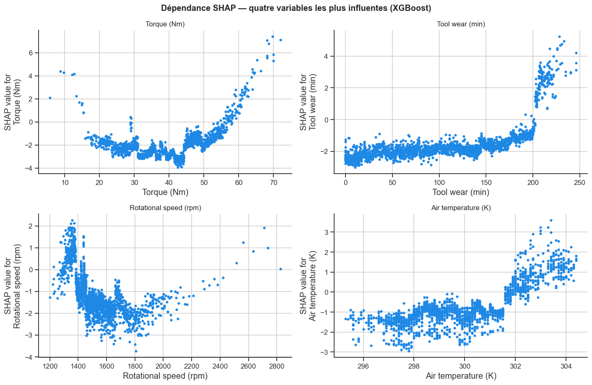
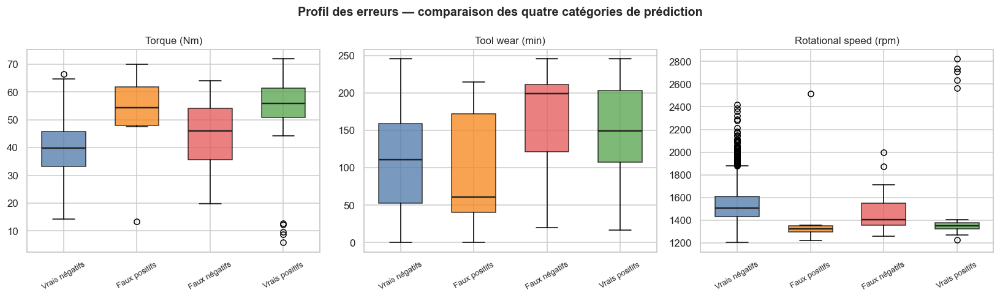
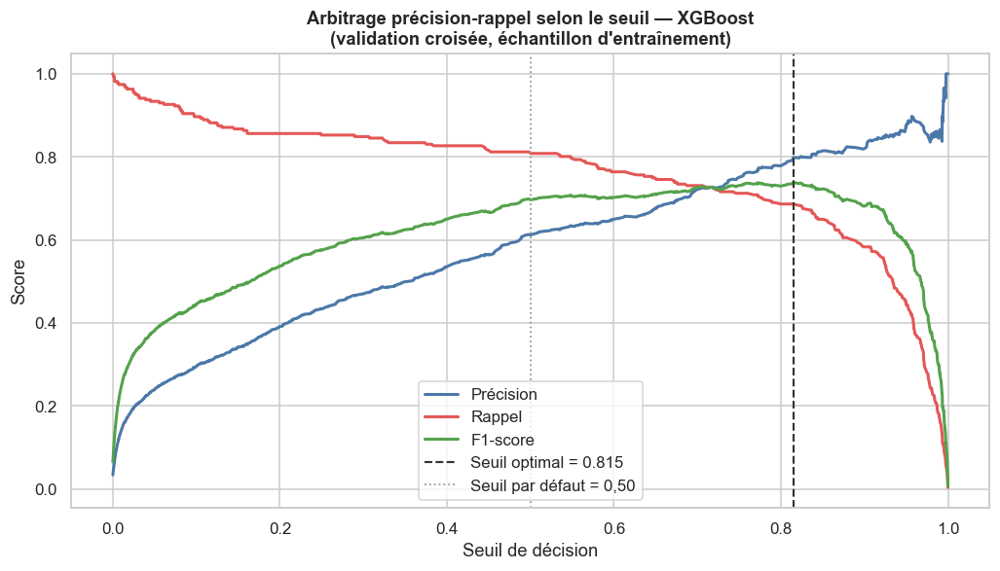

# Predictive Maintenance and Explainable Machine Learning

[Français](README.md) · **English**

Predicting industrial equipment failures from operating data, and explaining *why* the model predicts them — not merely *that* it does.

**Stack** — Python · Pandas · NumPy · scikit-learn · XGBoost · SHAP · Matplotlib · Seaborn

**Full report** — [PDF, 16 pages](predictive_maintenance_report_en.pdf) ([version française](rapport_maintenance_predictive.pdf))

---

## Problem

Unplanned equipment failures halt production lines and generate two distinct cost categories: lost output during downtime, and the premium of an emergency intervention over scheduled maintenance.

Anticipating these failures would allow interventions to be planned. The difficulty lies in a timing trade-off: intervening too early means replacing components that are still functional; intervening too late allows the very failure one sought to prevent. This trade-off structures the whole project, from the choice of metrics to the setting of the decision threshold.

**Research question**

> To what extent can Machine Learning models effectively detect failure risk, and which factors most influence their predictions?

**Hypothesis tested**

> Non-linear models should detect failures more effectively than logistic regression, but may produce more false positives.

---

## Data

[AI4I 2020 Predictive Maintenance Dataset](https://archive.ics.uci.edu/dataset/601/ai4i+2020+predictive+maintenance+dataset) — UCI Machine Learning Repository.

10,000 observations, 14 variables, **339 failures (3.39%)**. No missing values, no duplicates.

The dataset is not version-controlled. To reproduce the analysis, download `ai4i2020.csv` from the link above and place it in `data/raw/`.

### Variable selection

Of the 13 variables available besides the target, **6 are retained**:

| Variable | Role | Rationale |
|---|---|---|
| `Type` | Explanatory | Product quality (L / M / H) |
| `Air temperature [K]` | Explanatory | Ambient temperature |
| `Process temperature [K]` | Explanatory | Process temperature |
| `Rotational speed [rpm]` | Explanatory | Rotational speed |
| `Torque [Nm]` | Explanatory | Applied torque |
| `Tool wear [min]` | Explanatory | Cumulative tool wear |
| `Machine failure` | **Target** | Failure occurrence |
| `UDI`, `Product ID` | Excluded | Identifiers — 10,000 distinct values for 10,000 rows |
| `TWF`, `HDF`, `PWF`, `OSF`, `RNF` | Excluded | **Data leakage** |

The five indicators `TWF`, `HDF`, `PWF`, `OSF` and `RNF` designate the *mode* of failure observed. They are recorded only after the failure has occurred and would not be available at prediction time. Retaining them would yield a model with near-perfect test scores and no production value.

---

## Method

1. **Exploratory analysis** — distributions, correlations, class imbalance, outliers
2. **Preparation** — `Type` encoded as indicator variables, standardisation for logistic regression only
3. **Stratified train/test split** (80 / 20), failure rate preserved in both samples
4. **Imbalance compensation** — class weighting, applied identically to all three models
5. **Stratified cross-validation** over five folds on the training sample
6. **Evaluation** — precision, recall, F1, PR-AUC, confusion matrix
7. **Threshold tuning** on out-of-fold predictions, without consulting the test set
8. **Interpretation** through Shapley values (SHAP)
9. **Error analysis** on false positives and false negatives

### Why PR-AUC rather than accuracy

With 3.39% failures, always predicting "no failure" is enough to reach **96.6% accuracy** without detecting a single breakdown. PR-AUC is adopted as the primary metric: unlike ROC-AUC, it does not benefit mechanically from the abundance of true negatives, and it is threshold-independent.

---

## Results

### Cross-validation (5 folds, training sample)

| Model | PR-AUC | Standard deviation |
|---|---|---|
| Logistic Regression | 0.441 | ± 0.030 |
| Random Forest | 0.750 | ± 0.037 |
| XGBoost | 0.751 | ± 0.036 |

### Test set (2,000 observations, 68 failures) — threshold 0.50

| Model | Precision | Recall | F1 | PR-AUC | ROC-AUC |
|---|---|---|---|---|---|
| Logistic Regression | 0.142 | 0.824 | 0.242 | 0.382 | 0.907 |
| Random Forest | 0.808 | 0.618 | 0.700 | 0.774 | 0.971 |
| **XGBoost** | 0.609 | 0.824 | 0.700 | **0.813** | 0.972 |
| XGBoost (threshold 0.815) | **0.828** | 0.706 | **0.762** | 0.813 | 0.972 |



### Operational translation

| Model | Failures detected | Failures missed | False alerts |
|---|---|---|---|
| Logistic Regression | 56 / 68 | 12 | **339** |
| Random Forest | 42 / 68 | **26** | 10 |
| XGBoost | 56 / 68 | 12 | 36 |
| XGBoost (threshold 0.815) | 48 / 68 | 20 | 10 |





---

## Interpretation

### The hypothesis was half wrong

The first half holds: non-linear models detect failures far better, PR-AUC rising from 0.382 to 0.813.

**The second half is refuted.** Far from producing more false positives, XGBoost generates **nine times fewer** than logistic regression — 36 against 339.

The explanation lies in the geometry of the problem. Failures occur in **two opposing regimes**, overload and underload, located at opposite extremes of the same variable. No hyperplane can isolate two opposing regions without enclosing the central zone, where healthy observations concentrate. Logistic regression therefore achieves good recall (0.824) only by widening its alert zone dramatically: it triggers 395 interventions for 56 actual failures. Tree-based models partition the space and isolate each regime separately.

It is not the model's "power" that makes the difference, but **the fit between the shape of its decision boundary and the structure of the problem.**

### ROC-AUC versus PR-AUC

Logistic regression displays a ROC-AUC of 0.907 while issuing only one justified alert in seven. ROC-AUC incorporates true negatives, very abundant here, and gives a flattering picture of an unusable model. Its PR-AUC falls to 0.382. **An empirical demonstration of the metric choice.**

### What the model learned



| Variable | Share of importance |
|---|---|
| Torque (Nm) | 30.8% |
| Tool wear (min) | 25.1% |
| Rotational speed (rpm) | 18.8% |
| Air temperature (K) | 14.9% |
| Process temperature (K) | 7.7% |
| Type (L + M) | 2.7% |

The three mechanical variables concentrate **75% of total importance**.

Product quality accounts for only 2.7%, even though the raw failure rate is almost twice as high for lower-grade products (3.92% against 2.09%). The effect is **mediated by operating conditions**: lower-grade products are machined under more demanding regimes, already described by torque and speed. An illustration of the difference between marginal correlation and conditional contribution.



The dependence plots reveal distinctly non-linear relationships:

- **Torque traces a U-shaped curve** — minimum risk around 40–45 Nm, rising at both extremes. The two failure regimes appear explicitly.
- **Tool wear produces a threshold effect** — flat contribution up to 200 minutes, abrupt shift beyond. The model learned an implicit replacement threshold.
- **Rotational speed reproduces the torque U, inverted**, the two quantities being mechanically linked.
- **Air temperature shifts around 301.5 K.**

These shapes explain in a single figure why a linear model could not work.

### Error analysis



| | True negatives | False positives | False negatives | True positives |
|---|---|---|---|---|
| Torque (Nm) | 39.5 | **51.9** | 44.7 | 52.4 |
| Tool wear (min) | 107.5 | 94.4 | **170.3** | 146.3 |
| Rotational speed (rpm) | 1,539 | 1,430 | 1,476 | 1,481 |

**False negatives are wear-driven failures.** Their mean wear (170 min) exceeds that of detected failures (146 min), yet their torque remains ordinary (44.7 Nm). These are wear failures occurring under normal mechanical regimes. The model misses them because it relies primarily on instantaneous stress, whereas these failures arise from a cumulative process.

**False positives are at-risk states that did not escalate.** The highest torque of the four categories (51.9 Nm, exceeding even true positives), the lowest speed. They are **physically indistinguishable from failures** given the available variables. From a business standpoint, an alert here is early detection rather than error.

### Model selected

**XGBoost** is retained: the highest PR-AUC (0.813 against 0.774) and the better recall at comparable precision once the threshold is tuned.

Methodological caveat: in cross-validation, random forest and XGBoost are **statistically indistinguishable** (0.750 against 0.751, for standard deviations around 0.036). The gap measured on the test set partly reflects that particular sample and does not constitute an established superiority.

### On the decision threshold



The optimal threshold identified (0.815) far exceeds the 0.50 convention, a direct consequence of class weighting shifting predicted probabilities upward.

Tuning raises F1 from 0.700 to 0.762 and cuts false alerts by more than two thirds — but **eight additional failures escape detection**.

F1 weights precision and recall equally, which has no business justification. The threshold should derive from the ratio between the cost of unplanned downtime and that of an unnecessary intervention. Should a failure cost ten times more than a false alert, the 0.50 threshold remains preferable. **This is a business parameter, not a statistical constant.**

---

## Limitations

**Data**

- **Synthetic** dataset: relationships generated by deterministic rules, more regular than real sensor readings subject to noise and drift.
- **9 failures out of 339 carry no identified failure mode**, and 18 observations carry an `RNF` mode (stochastic failure, unpredictable by construction) without a failure label. These cases lower the attainable performance ceiling.
- **Only 68 failures in the test set**: each error shifts recall by 1.5 points. Small gaps between models are not meaningful.
- **Independence assumed.** Were these successive readings from one machine, a random train/test split would introduce temporal leakage.

**Protocol**

- **Hyperparameters not optimised** — no systematic search conducted.
- **No feature engineering**, even though the dataset's failure modes are defined from derived quantities (mechanical power, temperature gap). Constructing these would likely improve detection of the wear-driven failures currently missed.
- **Threshold optimised on F1**, in the absence of an explicit business cost function.
- **Strong collinearity** between the two temperatures (r ≈ 0.88) and between torque and speed (r ≈ −0.88): SHAP importance is distributed arbitrarily across redundant variables and does not measure causality.

---

## Further work

1. Construct derived variables (mechanical power, temperature gap, wear × torque interaction) and quantify their contribution through an ablation study.
2. Optimise hyperparameters by randomised search with cross-validation on PR-AUC.
3. Replace F1 with an explicit business cost function to set the threshold.
4. Replicate the protocol on real industrial data.

---

## Repository structure

```
.
├── notebooks/
│   ├── 01_eda.ipynb          # Exploration, variable selection, prepared dataset export
│   └── 02_modeling.ipynb     # Modelling, evaluation, SHAP, error analysis
├── data/
│   ├── raw/                  # ai4i2020.csv (not version-controlled — see Data)
│   └── processed/            # Prepared dataset, generated by 01_eda.ipynb
├── figures/                  # 16 figures + comparison table
├── requirements.txt
└── README.md
```

Note: the notebooks are written in French.

## Reproducing the analysis

```bash
python -m venv venv
source venv/bin/activate
pip install -r requirements.txt
```

On macOS, XGBoost requires the OpenMP library:

```bash
brew install libomp
```

Download `ai4i2020.csv` from [UCI](https://archive.ics.uci.edu/dataset/601/ai4i+2020+predictive+maintenance+dataset), place it in `data/raw/`, then run the notebooks in order:

```bash
jupyter lab
```

`01_eda.ipynb` generates `data/processed/ai4i2020_model.csv`, consumed by `02_modeling.ipynb`.
