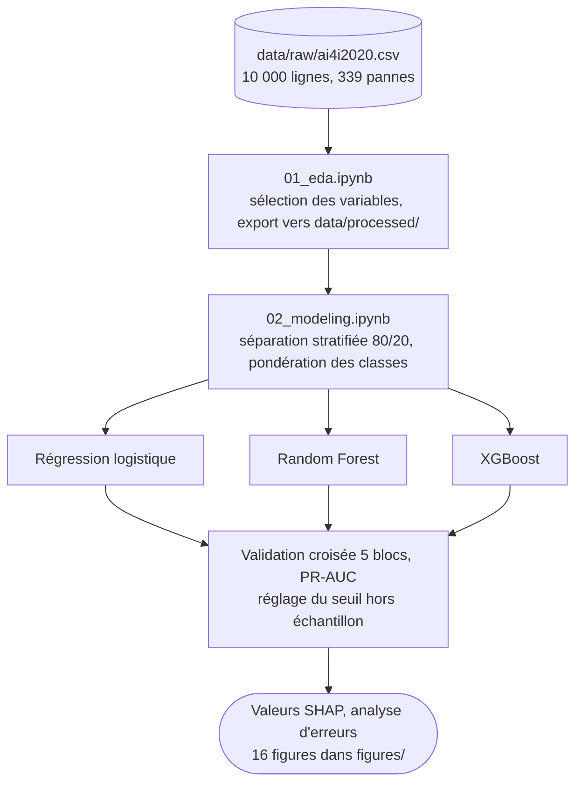

<p align="right"><a href="./README.md">English</a> | <b>Français</b></p>

<h1 align="center">Predictive Maintenance and Explainable ML</h1>

<p align="center">
  <a href="https://www.python.org"></a>
  <a href="https://jupyter.org"></a>
  <a href="https://scikit-learn.org"></a>
  <a href="https://xgboost.ai"></a>
  <a href="https://shap.readthedocs.io"></a>
  <a href="LICENSE"></a>
</p>

> **Prédire les pannes de machines industrielles à partir de leurs données de fonctionnement, et expliquer pourquoi le modèle les prédit.**

Les pannes imprévues immobilisent les lignes de production, mais intervenir trop tôt revient à remplacer des pièces encore fonctionnelles. Ce projet compare régression logistique, Random Forest et XGBoost sur le jeu de données AI4I 2020 (3,39 % de pannes), puis s'appuie sur SHAP et une analyse d'erreurs pour comprendre ce qui pilote chaque prédiction. XGBoost atteint une PR-AUC de 0,813 sur le jeu de test et déclenche neuf fois moins de fausses alertes que la référence linéaire, à rappel égal.

<p align="center">
  <a href="#résultats">Résultats</a> ·
  <a href="#ce-que-le-modèle-a-appris">Ce que le modèle a appris</a> ·
  <a href="#fonctionnement">Fonctionnement</a> ·
  <a href="#données">Données</a> ·
  <a href="#démarrage-rapide">Démarrage rapide</a> ·
  <a href="#documentation">Documentation</a>
</p>

<p align="center">
  
</p>

---

## Résultats

Jeu de test de 2 000 machines (68 pannes), séparation stratifiée 80/20, seuil de décision 0,50 sauf mention contraire.

| Modèle | Précision | Rappel | F1 | PR-AUC | ROC-AUC | Pannes manquées | Fausses alertes |
|---|---|---|---|---|---|---|---|
| Régression logistique | 0,142 | 0,824 | 0,242 | 0,382 | 0,907 | 12 | 339 |
| Random Forest | 0,808 | 0,618 | 0,700 | 0,774 | 0,971 | 26 | 10 |
| **XGBoost** | 0,609 | 0,824 | 0,700 | **0,813** | 0,972 | 12 | 36 |
| XGBoost, seuil 0,815 | 0,828 | 0,706 | 0,762 | 0,813 | 0,972 | 20 | 10 |

En validation croisée à 5 blocs sur l'échantillon d'entraînement, la PR-AUC vaut 0,441 (± 0,030) pour la régression logistique, 0,750 (± 0,037) pour Random Forest et 0,751 (± 0,036) pour XGBoost.

- **L'hypothèse était à moitié fausse.** On attendait des modèles non linéaires qu'ils détectent davantage de pannes au prix de plus de faux positifs. Ils en détectent bien plus, mais XGBoost déclenche 36 fausses alertes contre 339. Les pannes surviennent dans deux régimes opposés (surcharge et sous-charge) qu'aucun hyperplan ne peut isoler sans englober la zone centrale saine ; les arbres les séparent.
- **La ROC-AUC flatte un modèle inutilisable.** La régression logistique obtient 0,907 de ROC-AUC alors qu'une alerte sur sept seulement est justifiée. La PR-AUC, qui ignore les vrais négatifs très nombreux, tombe à 0,382.
- **Random Forest et XGBoost sont à égalité en validation croisée.** XGBoost est retenu pour sa PR-AUC en test, mais l'écart tient en partie à cet échantillon de test.
- **Le seuil est un paramètre métier.** Le passer à 0,815 (réglé sur les prédictions hors échantillon) fait monter le F1 de 0,700 à 0,762 et divise les fausses alertes par plus de trois, au prix de huit pannes manquées de plus. Si une panne coûte dix fois plus qu'une fausse alerte, le seuil de 0,50 reste préférable.

---

## Ce que le modèle a appris

<p align="center">
  
</p>

Le couple (30,8 %), l'usure de l'outil (25,1 %) et la vitesse de rotation (18,8 %) concentrent 75 % de l'importance SHAP. Les graphiques de dépendance sont nettement non linéaires : le risque suit une courbe en U selon le couple (minimum vers 40 à 45 Nm), bondit dès que l'usure dépasse 200 minutes et bascule au-delà de 301,5 K de température de l'air.

La qualité du produit ne pèse que 2,7 %, alors que les produits d'entrée de gamme tombent presque deux fois plus souvent en panne (3,92 % contre 2,09 %). L'effet passe par les conditions de fonctionnement : ces produits sont usinés dans des régimes plus durs, déjà décrits par le couple et la vitesse.

L'analyse d'erreurs (`figures/14_analyse_erreurs.png`) fait apparaître deux types d'erreurs. Les pannes manquées sont des pannes d'usure à couple ordinaire (usure moyenne 170 min, couple 44,7 Nm) : le modèle s'appuie sur la contrainte instantanée et rate ce processus cumulatif. Les fausses alertes ont le couple le plus élevé des quatre groupes (51,9 Nm) : physiquement proches de vraies pannes, elles relèvent davantage de la détection précoce que de l'erreur.

---

## Fonctionnement



- [`notebooks/01_eda.ipynb`](notebooks/01_eda.ipynb) explore les données et retient 6 variables explicatives : `Type`, les deux températures, la vitesse de rotation, le couple et l'usure de l'outil.
- Les identifiants `UDI` et `Product ID` sont écartés, tout comme les indicateurs de mode de défaillance `TWF`, `HDF`, `PWF`, `OSF` et `RNF` : ils ne sont connus qu'après la panne, les garder serait une fuite de données.
- [`notebooks/02_modeling.ipynb`](notebooks/02_modeling.ipynb) encode `Type` en variables indicatrices, standardise les variables pour la seule régression logistique et applique la même pondération des classes aux trois modèles.
- La PR-AUC est la métrique principale : prédire systématiquement « pas de panne » donne déjà 96,6 % d'accuracy.

Les notebooks et les libellés des figures sont rédigés en français.

---

## Données

[AI4I 2020 Predictive Maintenance Dataset](https://archive.ics.uci.edu/dataset/601/ai4i+2020+predictive+maintenance+dataset), UCI Machine Learning Repository : 10 000 lignes, 14 colonnes, 339 pannes (3,39 %), aucune valeur manquante ni doublon.

Le CSV n'est pas versionné. Téléchargez `ai4i2020.csv` depuis le lien ci-dessus et placez-le dans `data/raw/`.

Le jeu de données est synthétique : ses relations sont plus régulières que celles de vrais capteurs. Neuf pannes n'ont pas de mode identifié, et le jeu de test ne compte que 68 pannes, si bien que chaque erreur déplace le rappel de 1,5 point.

---

## Démarrage rapide

```bash
git clone https://github.com/Yvngval/Predictive-Maintenance-Explainable-ML-.git
cd Predictive-Maintenance-Explainable-ML-
python -m venv venv
source venv/bin/activate
pip install -r requirements.txt
```

Sur macOS, XGBoost a besoin d'OpenMP :

```bash
brew install libomp
```

Placez `ai4i2020.csv` dans `data/raw/`, puis exécutez les notebooks dans l'ordre :

```bash
jupyter lab
```

`01_eda.ipynb` génère `data/processed/ai4i2020_model.csv`, que lit `02_modeling.ipynb`.

---

## Documentation

| Document | Contenu |
|---|---|
| [predictive_maintenance_report_en.pdf](predictive_maintenance_report_en.pdf) | Rapport complet en anglais (16 pages) : méthode, résultats, limites, prolongements |
| [rapport_maintenance_predictive.pdf](rapport_maintenance_predictive.pdf) | Le même rapport en français (18 pages) |

Limites connues, détaillées dans le rapport : hyperparamètres non optimisés, aucune variable dérivée construite (puissance mécanique, écart de températures), seuil réglé sur le F1 faute de fonction de coût métier, et forte colinéarité (r ≈ 0,88 entre les deux températures) qui répartit l'importance SHAP entre variables redondantes.

---

## Structure du projet

```text
notebooks/01_eda.ipynb        exploration, sélection des variables, export du jeu préparé
notebooks/02_modeling.ipynb   modèles, évaluation, SHAP, analyse d'erreurs
data/raw/                     ai4i2020.csv (non versionné)
data/processed/               jeu préparé, généré par 01_eda.ipynb
figures/                      16 figures et tableau_comparatif.csv
*.pdf                         rapport en anglais et en français
```

---

## Contribuer

Les issues et pull requests sont les bienvenues. Voir [CONTRIBUTING.md](CONTRIBUTING.md).

## Licence

Le code est publié sous [licence MIT](LICENSE). Le jeu de données AI4I 2020 est publié par l'UCI Machine Learning Repository sous licence CC BY 4.0.

## Auteurs

<a href="https://github.com/Yvngval"></a>

Valentin Ponnoussamy ([@Yvngval](https://github.com/Yvngval)), Master Data Science, 2026.
