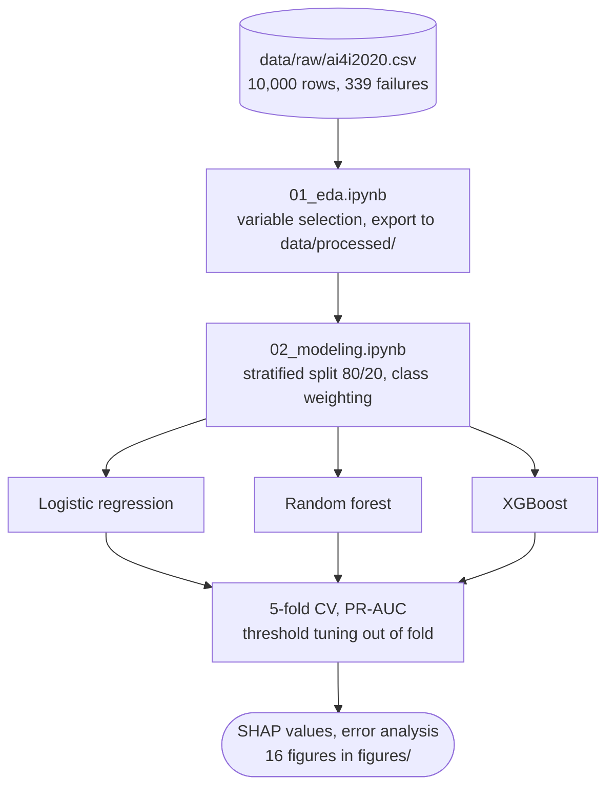

<p align="right"><b>English</b> | <a href="./README.fr.md">Français</a></p>

<h1 align="center">Predictive Maintenance and Explainable ML</h1>

<p align="center">
  <a href="https://www.python.org"></a>
  <a href="https://jupyter.org"></a>
  <a href="https://scikit-learn.org"></a>
  <a href="https://xgboost.ai"></a>
  <a href="https://shap.readthedocs.io"></a>
  <a href="LICENSE"></a>
</p>

> **Predict industrial machine failures from operating data, and explain why the model predicts them.**

Unplanned failures stop production lines, but intervening too early replaces parts that still work. This project compares logistic regression, random forest and XGBoost on the AI4I 2020 dataset (3.39% failures), then uses SHAP and an error analysis to understand what drives each prediction. XGBoost reaches a PR-AUC of 0.813 on the test set and raises nine times fewer false alerts than the linear baseline for the same recall.

<p align="center">
  <a href="#results">Results</a> ·
  <a href="#what-the-model-learned">What the model learned</a> ·
  <a href="#how-it-works">How it works</a> ·
  <a href="#data">Data</a> ·
  <a href="#getting-started">Getting started</a> ·
  <a href="#documentation">Documentation</a>
</p>

<p align="center">
  
</p>

---

## Results

Test set of 2,000 machines (68 failures), stratified 80/20 split, decision threshold 0.50 unless stated.

| Model | Precision | Recall | F1 | PR-AUC | ROC-AUC | Missed failures | False alerts |
|---|---|---|---|---|---|---|---|
| Logistic regression | 0.142 | 0.824 | 0.242 | 0.382 | 0.907 | 12 | 339 |
| Random forest | 0.808 | 0.618 | 0.700 | 0.774 | 0.971 | 26 | 10 |
| **XGBoost** | 0.609 | 0.824 | 0.700 | **0.813** | 0.972 | 12 | 36 |
| XGBoost, threshold 0.815 | 0.828 | 0.706 | 0.762 | 0.813 | 0.972 | 20 | 10 |

In 5-fold cross-validation on the training set, PR-AUC is 0.441 (± 0.030) for logistic regression, 0.750 (± 0.037) for random forest and 0.751 (± 0.036) for XGBoost.

- **The hypothesis was half wrong.** Non-linear models were expected to detect more failures at the cost of more false positives. They do detect more, but XGBoost raises 36 false alerts against 339. Failures occur in two opposite regimes (overload and underload) that no hyperplane can isolate without enclosing the healthy center; trees split them apart.
- **ROC-AUC flatters a useless model.** Logistic regression scores 0.907 ROC-AUC while only one alert in seven is justified. PR-AUC, which ignores the abundant true negatives, drops to 0.382.
- **Random forest and XGBoost are tied in cross-validation.** XGBoost is kept for its test PR-AUC, but the gap partly reflects this particular test sample.
- **The threshold is a business parameter.** Moving it to 0.815 (tuned on out-of-fold predictions) lifts F1 from 0.700 to 0.762 and cuts false alerts by more than two thirds, at the cost of eight more missed failures. If a failure costs ten times a false alert, 0.50 stays the better choice.

---

## What the model learned

<p align="center">
  
</p>

Torque (30.8%), tool wear (25.1%) and rotational speed (18.8%) carry 75% of the SHAP importance. The dependence plots are clearly non-linear: risk follows a U shape in torque (lowest around 40 to 45 Nm), jumps once tool wear passes 200 minutes, and shifts above 301.5 K of air temperature.

Product quality weighs only 2.7%, although lower-grade products fail almost twice as often (3.92% against 2.09%). The effect goes through operating conditions: those products are machined under harsher regimes, already captured by torque and speed.

The error analysis (`figures/14_analyse_erreurs.png`) shows two kinds of mistakes. Missed failures are wear failures under ordinary torque (mean wear 170 min, torque 44.7 Nm): the model relies on instantaneous stress and misses this cumulative process. False alerts have the highest torque of all four groups (51.9 Nm), so they are physically close to real failures and read more like early warnings than errors.

---

## How it works



- [`notebooks/01_eda.ipynb`](notebooks/01_eda.ipynb) explores the data and keeps 6 explanatory variables: `Type`, the two temperatures, rotational speed, torque and tool wear.
- The identifiers `UDI` and `Product ID` are dropped, and so are the failure-mode flags `TWF`, `HDF`, `PWF`, `OSF` and `RNF`: they are only known after the failure, so keeping them would be data leakage.
- [`notebooks/02_modeling.ipynb`](notebooks/02_modeling.ipynb) one-hot encodes `Type`, standardizes features for logistic regression only, and applies the same class weighting to all three models.
- PR-AUC is the main metric: always predicting "no failure" already gives 96.6% accuracy.

The notebooks and figure labels are written in French.

---

## Data

[AI4I 2020 Predictive Maintenance Dataset](https://archive.ics.uci.edu/dataset/601/ai4i+2020+predictive+maintenance+dataset), UCI Machine Learning Repository: 10,000 rows, 14 columns, 339 failures (3.39%), no missing values and no duplicates.

The CSV is not versioned. Download `ai4i2020.csv` from the link above and place it in `data/raw/`.

The dataset is synthetic, so its relationships are more regular than real sensor data. Nine failures have no identified mode, and the test set holds only 68 failures, so each error moves recall by 1.5 points.

---

## Getting started

```bash
git clone https://github.com/Yvngval/Predictive-Maintenance-Explainable-ML-.git
cd Predictive-Maintenance-Explainable-ML-
python -m venv venv
source venv/bin/activate
pip install -r requirements.txt
```

On macOS, XGBoost needs OpenMP:

```bash
brew install libomp
```

Put `ai4i2020.csv` in `data/raw/`, then run the notebooks in order:

```bash
jupyter lab
```

`01_eda.ipynb` writes `data/processed/ai4i2020_model.csv`, which `02_modeling.ipynb` reads.

---

## Documentation

| Document | Content |
|---|---|
| [predictive_maintenance_report_en.pdf](predictive_maintenance_report_en.pdf) | Full report in English (16 pages): method, results, limitations, further work |
| [rapport_maintenance_predictive.pdf](rapport_maintenance_predictive.pdf) | Same report in French (18 pages) |

Known limitations, detailed in the report: hyperparameters were not tuned, no derived features (mechanical power, temperature gap) were built, the threshold is tuned on F1 rather than a business cost, and strong collinearity (r ≈ 0.88 between the two temperatures) spreads SHAP importance across redundant variables.

---

## Project structure

```text
notebooks/01_eda.ipynb        exploration, variable selection, prepared dataset export
notebooks/02_modeling.ipynb   models, evaluation, SHAP, error analysis
data/raw/                     ai4i2020.csv (not versioned)
data/processed/               prepared dataset, written by 01_eda.ipynb
figures/                      16 figures and tableau_comparatif.csv
*.pdf                         report in English and French
```

---

## Contributing

Issues and pull requests are welcome. See [CONTRIBUTING.md](CONTRIBUTING.md).

## License

The code is released under the [MIT License](LICENSE). The AI4I 2020 dataset is published by the UCI Machine Learning Repository under CC BY 4.0.

## Authors

<a href="https://github.com/Yvngval"></a>

Valentin Ponnoussamy ([@Yvngval](https://github.com/Yvngval)), Master's in Data Science, 2026.
